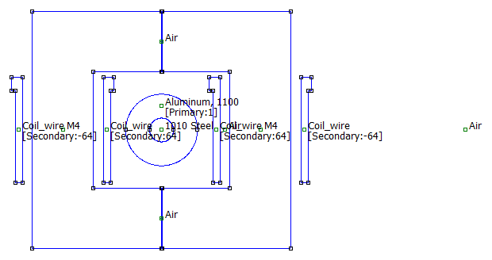
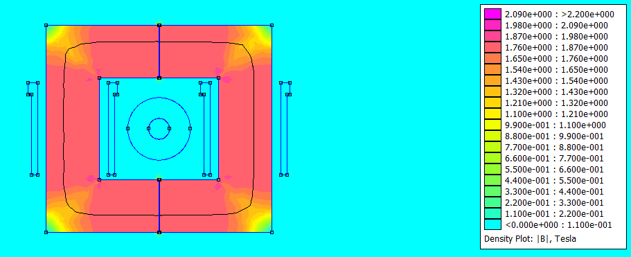
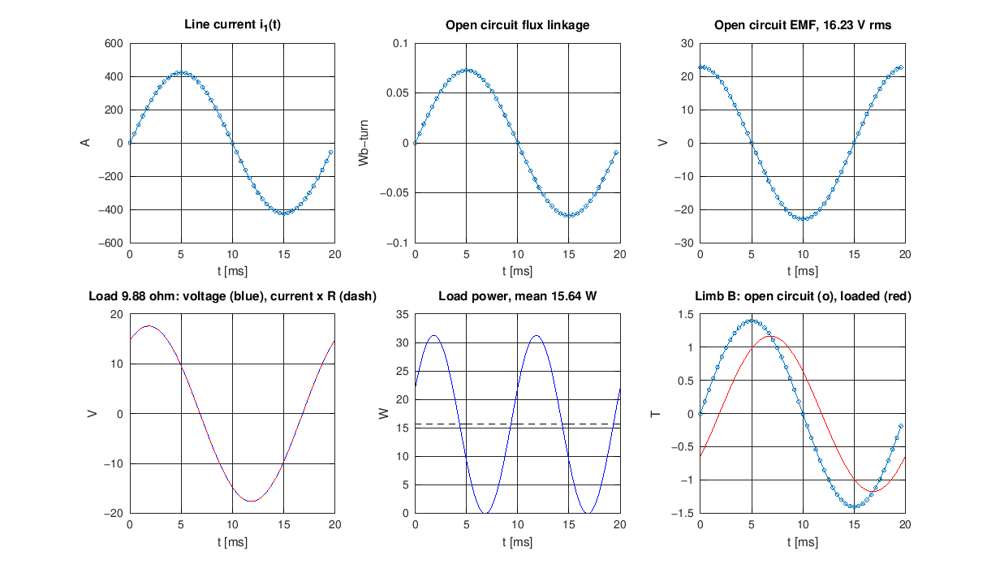

# Split-core CT energy harvester: FEMM and Octave simulation

Simulation of a 500 g split-core current transformer that clamps onto an overhead line (ACSR Dog,
50 Hz, 200 to 500 A) and charges a 2S Li-ion pack for a drone. The core is nonlinear grain-oriented
steel, so the study drives FEMM from GNU Octave and steps the line current through a sine wave
instead of using FEMM's linear AC solver.



## What is modelled

| Item | Value |
|---|---|
| Core | M-4 grain-oriented steel, 0.27 mm, stacking factor 0.965 |
| Core size | outer 51 x 47 mm, window 27 x 23 mm, limb 12 mm, stack 34 mm |
| Joints | two butt joints of 0.2 mm (top and bottom limb) |
| Secondary | N2 = 128 (64 per limb), AWG 22, R1 = 0.74 ohm at 20 C |
| Primary | one pass of ACSR Dog, 14.15 mm, steel core and aluminium ring |
| Load | resistor, or Schottky bridge into a CC/CV buck charger and a 2S pack |

The steel B-H curve and loss coefficients come from the ATI Allegheny Ludlum grain-oriented steel
data (2012). They are typical values, not a supplier curve for the actual laminations.

## Method

1. `ct_sine_femm` solves the nonlinear magnetostatic problem at stepped values of the line current.
   Without hysteresis only a quarter cycle is needed. A grid of flux linkage against line current
   and secondary current is stored as well.
2. `ct_load_sim` integrates `d(lambda2)/dt = -R1 i2 + vt` with RK4, reading `lambda2(i1, i2)` from that
   table. The terminal voltage `vt` is a resistor or a diode bridge into a held DC link. Core loss
   enters as a resistance across the induced voltage, with the loss itself from a hysteresis and
   eddy split evaluated on the local flux density map.
3. `ct_leakage` finds the leakage inductance from FEMM, including end turns, using an axisymmetric
   model of the same coil on a round limb.
4. `ct_thermal` is a two-node lumped model of core and winding in still air.



## Results

Line current 300 A rms and 500 A rms, open circuit and loaded.

| | 300 A | 500 A |
|---|---|---|
| Open-circuit voltage | 16.2 V rms | 23.7 V rms (28 % distortion) |
| Peak flux density in the steel | 1.45 T | 1.93 T |
| Power in 9.88 ohm | 15.6 W | 38.7 W |
| Best resistive load | 7.07 ohm, 16.4 W | 6.26 ohm, 43.6 W |
| Bridge into DC link | 12.2 W at 9.1 V | 33.0 W at 13.6 V |
| Into the battery (90 % buck) | 11.0 W | 29.7 W |
| Winding / core temperature (h = 10 W/m2K, 40 C ambient) | 64 / 61 C | 127 / 114 C |

Other results:

- Leakage inductance 0.29 mH, which is 1.3 % of the magnetizing inductance (the design report assumed 62 %).
- Magnetizing inductance 22.08 mH from FEMM against 20.09 mH from the lumped hand calculation.
- Total mass 499.0 g (steel 444.6 g, copper 40.9 g, bobbins 13.6 g).
- At 500 A the core saturates and the output voltage rises by 46 % for a 67 % rise in current.
- Moving the conductor up to 3 mm sideways or 4 mm up or down in the window changes the open-circuit
  flux linkage by 0.06 % at most and the near-short-circuit flux linkage by about 1 % (`ct_offset_study`).
- A PLA bobbin would soften at 500 A. Use a higher-temperature material.

The full printed output of each run is in `results/results_300A.txt` and `results/results_500A.txt`.



## Checks

- Interpolated flux-linkage table against direct FEMM solves at the simulated operating points:
  worst error 0.76 % (300 A) and 1.04 % (500 A) of peak (`ct_sine_check`).
- FEMM harmonic solver with a linear core agrees with the stepped nonlinear result to 0.9 %.
- The cycle repeats to better than 1e-14 A after ten cycles of the time stepping.

## Repository layout

```
src/            Octave scripts (ct_setup.m sets paths, ct_params.m holds all data)
src/legacy/     the stage 2 model from the design report, for comparison
models/         FEMM .fem files written by the scripts
models/legacy/  original btp.fem and ct_model_v2.fem
results/        .dat files, printed results and figures written by the scripts
docs/           written report and model pictures
```

## Running

Requirements: GNU Octave 11 with the FEMM 4.2 `octavefemm` interface (default `C:\femm42\mfiles`,
or set the `FEMM_MFILES` environment variable). Windows only, because FEMM is.

```
octave-cli --eval "addpath('src'); run_study"
```

`run_study(true)` skips the FEMM steps and recomputes everything from the saved `.dat` files, which
takes a few minutes. A full run with FEMM takes noticeably longer (about 200 nonlinear solves per
current level). Single steps can be run on their own, for example

```
octave-cli --eval "addpath('src'); I1rms = 500; Tw = 125; ct_load_sim"
```

`Tw` is the winding temperature used for R1. The 500 A run uses 125 C to match the thermal result.
To try a different design, edit `src/ct_params.m` and rerun.

## Assumptions to replace with measurements

- Diode dynamic resistance 0.03 ohm, battery 3 Ah with 0.12 ohm internal resistance.
- Convection coefficient 10 W/m2K and a line temperature of 75 C at 300 A.
- M-4 curve is typical data, interpolated between 1.6 T and 1.85 T. Loss above 1.8 T is extrapolated.
- End-turn leakage is estimated from an axisymmetric model and a formula, not a 3D solve.

Measure Lm, leakage, R1 and the real load on the built CT, then update `ct_params.m`.

## License

MIT, see [LICENSE](LICENSE).
